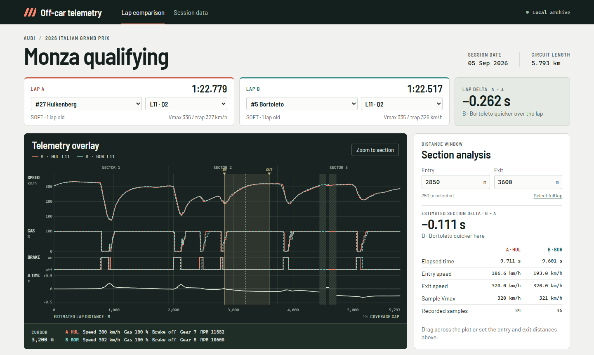

# Audi off-car telemetry · Monza 2026

A post-session engineering tool for the two Audi cars in Italian Grand Prix qualifying. It collects public telemetry, archives the source responses, builds an indexed SQLite database and compares two laps by distance. The default comparison reproduces the Q2 times of Nico Hülkenberg and Gabriel Bortoleto on 5 September 2026. [FIA qualifying classification](https://www.fia.com/events/fia-formula-one-world-championship/season-2026/italian-grand-prix/qualifying-classification)

## Run it with one command

Unpack the project, open a terminal in the folder containing `telemetry.py`, and run it with a standard Python 3.10+ installation. All runtime dependencies are in the standard library.

```sh
python telemetry.py
```

The Windows Python launcher accepts **`py telemetry.py`**. If your interpreter is named `python3` on macOS or Linux, use **`python3 telemetry.py`**.

The first run downloads both cars from OpenF1 into **monza-demo/**, checks the archived responses, builds SQLite, checks database integrity and foreign keys, and opens the comparison in your default browser. For this session, expect **16,909 samples per car** and a default Q2 lap delta of **−0.262 s**. The terminal prints the per-car counts and the full path to the generated HTML.

Run the same command again to resume an interrupted download. Once all responses are cached, the command also works offline. If your environment cannot launch a browser, open **monza-demo/comparison.html** manually.



## Open the session

The generated viewer includes its data, plots, fonts and controls in one HTML file. For an instant preview, the project also includes **comparison.html** and a reference snapshot under **data/**.

1. Choose a driver and lap for each slot. The two slots can use the same driver. The starting pair uses the fastest eligible laps on a common tyre compound in the latest qualifying phase both drivers reached.
2. Drag across the plot to select a section, drag the two markers individually, or enter the distances in metres. **Zoom to section** expands the selected window. Hover to inspect RPM, gear and controls. With the plot focused, the arrow keys move the cursor by 10 m, or 100 m with Shift.
3. Read the **B − A** delta. A negative value means B covered the same distance in less time. Section entry and exit speeds are interpolated. Section Vmax uses only recorded samples inside the window.
4. Open **Session data** for the full lap register, archived race-control messages and the measured browser opening time.

## A reproducible comparison

Both drivers set their best Q2 time on lap 11, on soft tyres. The two maxima below apply to those particular laps. [Hülkenberg lap record](https://api.openf1.org/v1/laps?session_key=11357&driver_number=27&lap_number=11) · [Bortoleto lap record](https://api.openf1.org/v1/laps?session_key=11357&driver_number=5&lap_number=11)

| Q2, lap 11 | A · Hülkenberg #27 | B · Bortoleto #5 |
|---|---:|---:|
| Published lap time | 1:22.779 | 1:22.517 |
| Highest observed speed | 336 km/h | 335 km/h |
| Speed at the trap | 327 km/h | 326 km/h |
| Samples inside the timed lap | 308 | 306 |
| Largest sample interval | 1.12 s | 1.12 s |

Bortoleto was 0.262 s quicker over the lap. The viewer initially selects **2,850–3,600 m**. At the estimated entry point the cars were travelling at 186.6 and 193.0 km/h respectively. Both reached about 320 km/h by the exit. The estimated section time favours Bortoleto by approximately 0.11 s. Deltas use the underlying unrounded values.

The same pair demonstrates an uncertainty check. Selecting **4,400–4,570 m** crosses a gap in Hülkenberg's trace. The viewer shows the available B metrics and withholds the section delta. For a continuous full-lap distance comparison, select lap 5 for both cars in Q1.

## Run the pipeline

Python 3.10 or newer is sufficient. All collection, storage and rendering code uses the standard library. Run the following commands from the project folder.

| Command | Result |
|---|---|
| `python telemetry.py collect --workspace monza-demo` | Downloads or resumes the same demo and builds its files for headless use |
| `python telemetry.py collect` | Verifies and reuses the bundled checkpoints, fetches any missing ones and rebuilds the outputs |
| `python telemetry.py collect --refresh` | Starts a fresh source download in the project folder |
| `python telemetry.py rebuild` | Verifies the completed local archive and regenerates SQLite, HTML and benchmark results entirely offline |
| `python telemetry.py benchmark` | Prints local read and alignment timings for the selected default pair |

To resume after an interruption, run **collect** again with the same workspace. Use `--refresh` only when starting a new download. The raw manifest reports `incomplete` until all required responses are checkpointed. The previous published database and standalone viewer stay usable during collection.

## Storage and provenance

The dataset is scoped to OpenF1 session **11357**. The collector resolves the two Audi entries from the roster and filters every telemetry request by driver. It retains the session-wide race-control feed for context. The two cars each have 16,909 archived samples. That total includes garage and pre-session records associated with the session key. The register contains 24 laps, of which eight are timed laps eligible for comparison. [Session metadata](https://api.openf1.org/v1/sessions?session_key=11357) · [OpenF1 channels and fields](https://openf1.org/docs/)

| File or table | Contents |
|---|---|
| `data/raw/11357/` | Original response bodies in JSON.gz. A manifest records request URLs, UTC retrieval times, HTTP status, row counts, download timings and SHA-256 checksums |
| `data/telemetry.sqlite` → `telemetry` | One row per session, driver and UTC microsecond. The composite primary key orders range reads. Speed is in km/h. Raw throttle, brake, gear and RPM retain source values and nulls |
| `laps` | One row per session, driver and lap. It stores the approximate start, duration, three split times, intermediate and trap speeds, and pit-lane evidence |
| `sessions`, `drivers`, `stints`, `pit_visits`, `race_control` | Driver identities, session times, tyre runs and track context |
| `data/benchmark.json` | Environment, file sizes, request timings, processing times and local two-lap read latency for the most recent build |

The car-data requests use disjoint ten-minute windows with open outer ends. This keeps the first and last samples even when they fall outside the scheduled hour. Each checkpoint is published with a temporary file and atomic rename. SQLite is built and checked in a staging directory. A writer lock serialises collectors. Publishing to an existing database uses SQLite's backup transaction and WAL so an existing reader can finish its prior snapshot.

## Alignment and quality rules

- A timed lap owns samples from its start inclusive to its finish exclusive. Nearby bracketing observations allow the engine to interpolate boundary speeds. Boundary estimates do not count towards observed Vmax.
- The engine integrates speed with the trapezoidal rule using actual UTC intervals. A continuous lap receives one length correction to the published 5,793 m centreline. The independent intermediate checks use 1,909 m and 3,732 m on the circuit. [FIA circuit map, page 2](https://www.fia.com/system/files/decision-document/2026_italian_grand_prix_-_competition_notes_-_circuit_map_pit_lane_drawing_emergency_exits_map_and_red_zone.pdf)
- A missing speed or interval above **1.0 s** splits the distance trace. This threshold is a project choice for a feed sampled at roughly 3.7 Hz. A disconnected piece can be positioned from the start, finish or a published sector timing line. Unanchored pieces and ambiguous overlaps are excluded from distance calculations. Hatching marks missing coverage. A section result requires both endpoints and everything between them to belong to one continuous piece for that car. [OpenF1 car data](https://openf1.org/docs/#car-data)
- Timing-line checks report the estimated cumulative delta alongside the published one. Any line used as an anchor is identified. In the default Q2 pair, the S1 and S2 residuals are approximately +0.017 s and +0.072 s. Differences of this size matter when interpreting a small gain.
- Out-laps, in-laps, incomplete laps and identified deleted laps are excluded from automatic selection. In this qualifying session OpenF1 returned an empty result for each car's pit endpoint. Pit-lane mini-sector code 2064 and the following out-lap provide in-lap evidence. Qualifying phase is determined from session-start messages. Caution labels describe flags active during a lap, including sector-specific cautions. [OpenF1 laps](https://openf1.org/docs/#laps) · [OpenF1 race control](https://openf1.org/docs/#race-control)
- OpenF1 defines brake codes 0 and 100. The archive includes some brake and throttle values of 104. The working database retains them, while the viewer treats an undocumented brake code or out-of-range throttle as unknown. Gear, RPM and pedal readings in the cursor use the preceding observation within the current piece. [OpenF1 field definitions](https://openf1.org/docs/#car-data)
- A speed drop at full throttle can be examined directly on the plots. Battery state of charge and MGU-K electrical power are unavailable in this dataset, so a particular recovery mode cannot be confirmed from these traces.

## Performance and verification

On a Ryzen 5 7500F running Windows 11 and Python 3.12.14, the initial 21 source requests took **55.0 s** in aggregate. The compressed response bodies occupy **234,379 bytes** and the completed SQLite database **1,040,384 bytes**. A local run imported and checked the archive in approximately **0.16 s**. Querying and aligning the two Q2 laps took about **1.2 ms median** across 40 iterations on an open SQLite connection. The viewer measures its own opening time through the first chart render and font load. These measurements cover different stages and can be repeated independently.

Run the offline regression checks from the project directory. Node.js 18+ is used only for the JavaScript tests.

```sh
python -m unittest discover -s tests -v
node --test tests/compare.test.cjs
```

The checks cover checkpoint recovery, source precision, concurrent SQL snapshots, late deletions, missing controls, independent distance pieces, the sign of a sector delta and the actual Monza timing records. The browser viewer has also been exercised offline with both driver selections, same-driver laps, draggable and numeric windows, keyboard inspection and a narrow mobile viewport.
